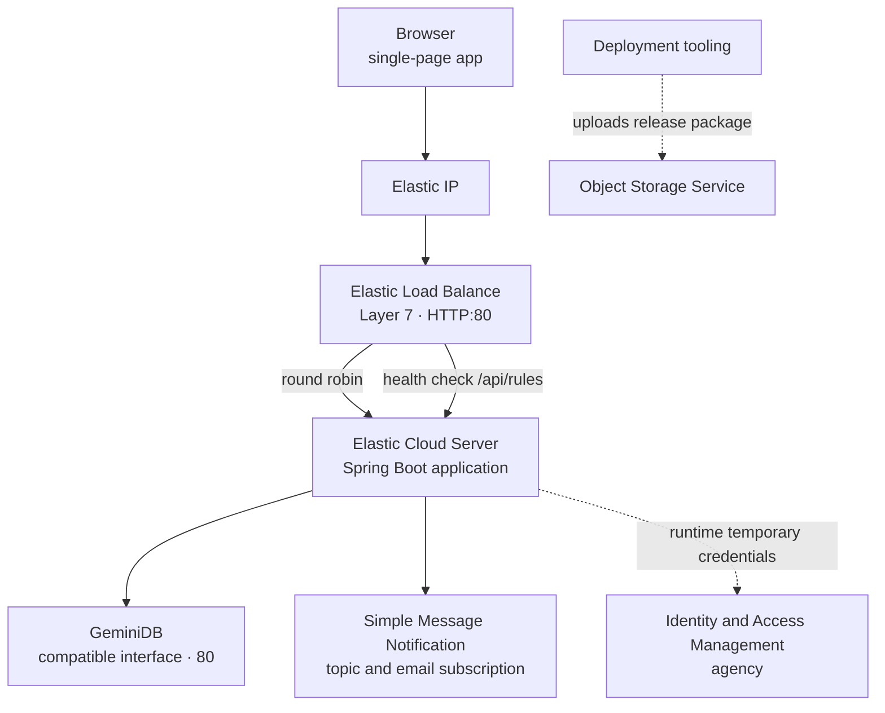

# Scorekeep Game Record Service


## 1. Overview

Scorekeep is a playable game record service. The backend is a Java application built on Spring that exposes an HTTP API for creating and managing sessions, players, games, moves, and board states. The frontend is a single-page application served by the same process as the API. Every move on the board is recorded, and the service publishes a notification when a game ends.

This practice runs the service on Huawei Cloud. Compute, ingress, wide-column storage, object storage, notification, and authorization all use Huawei Cloud services, and the whole infrastructure is declared in Terraform. It is intended for readers who want to see how a "Java application + wide-column storage + Layer 7 load balancing" combination is assembled on Huawei Cloud, and it also works as a starter sample for bringing a Spring Boot application to the cloud.

## Table of Contents

- [Architecture](#architecture)
- [Highlights](#highlights)
- [Huawei Cloud Services Used](#huawei-cloud-services-used)
- [Prerequisites](#prerequisites)
- [Quick Start](#quick-start)
- [Step-by-Step Deployment](#step-by-step-deployment)
- [Usage and Verification](#usage-and-verification)
- [Cleanup](#cleanup)
- [Detailed Description](#detailed-description)
- [Dependencies](#dependencies)
- [FAQ](#faq)
- [Contributing](#contributing)
- [License](#license)
- [Contact](#contact)

## Architecture



**Request path**: The browser reaches the Layer 7 load balancer through an Elastic IP. The load balancer distributes requests across the backend instances in round-robin order and probes `/api/rules` periodically to decide whether an instance is healthy. Each instance serves both the pages and the API, so the two share an origin and no cross-origin configuration is needed.

**Data path**: The application writes five kinds of records to the GeminiDB compatible interface instance: players, sessions, games, moves, and states. Fetching games by session, and moves or states by game, goes through secondary indexes on the instance.

**Authorization path**: Each application instance is bound to an Identity and Access Management agency and obtains temporary credentials from the instance metadata service at runtime to publish events. No long-term key is stored on the instance.

**Release path**: After the executable package is built locally, Terraform uploads it to the Object Storage Service bucket for record keeping and pushes it to the application instances over SSH, where it runs as a system service.

## Highlights

- **One declarative infrastructure**: More than twenty resources across compute, network, ingress, storage, notification, and authorization are described by Terraform. A single command creates them, and the orchestrator derives the dependency order, so no manual sequencing is required.
- **Pages and API in one process**: Frontend assets are merged into the application package at build time and served by the same Java process. Pages and API share an origin, which removes cross-origin configuration and separate static hosting.
- **Data-plane credentials stay on the instance**: The application reaches wide-column storage with the database account provided by the instance, and reaches the notification service with temporary credentials issued to the agency. Neither requires a long-term key on the instance disk.
- **Schema created at startup**: The application creates the tables and secondary indexes it needs when it starts, idempotently. If a table already exists, only missing indexes are added, so the first deployment needs no manual data-plane preparation.
- **Runs as a managed service**: Deployment registers the application as a system service with automatic restart, so the service recovers by itself after an instance reboots.

## Huawei Cloud Services Used

| Service | Role in this practice |
|---|---|
| Elastic Cloud Server (ECS) | Runs the Spring Boot application, serving both pages and API |
| Elastic Load Balance (ELB, dedicated, Layer 7) | Single entry point; distributes requests in round-robin order and performs health checks |
| Elastic IP (EIP) | Provides public addresses for the load balancer and for operations access |
| Virtual Private Cloud (VPC) | Hosts the subnet, security group, and internet gateway, isolating the network boundary |
| GeminiDB (compatible interface) | Stores players, sessions, games, moves, and states |
| Object Storage Service (OBS) | Holds the release package |
| Simple Message Notification (SMN) | Publishes player-created and game-finished events, with email subscription support |
| Identity and Access Management (IAM) | Issues runtime temporary credentials to instances through an agency |

> After trying the practice, follow the [Cleanup](#cleanup) section to release the resources above and avoid leaving anything behind.

## Prerequisites

**Account and permissions**

- An active Huawei Cloud account with permission to create VPC, ECS, ELB, EIP, GeminiDB, OBS, SMN, and IAM agency resources.
- An Access Key and Secret Key obtained from the **My Credentials** page of the console, plus the account domain name.
- Dedicated Layer 7 load balancing enabled for the account. If it is not enabled, creating the load balancer returns `ELB.8902`, and a service ticket is required first.

**Tool versions**

| Tool | Requirement |
|---|---|
| Terraform | 1.5 or later (verified on 1.15 in this practice) |
| huaweicloud Provider | 1.97 |
| JDK | 17 |
| Gradle | 8.13 (the wrapper ships with the repository, no separate install needed) |
| Bash | Built into Linux and macOS; on Windows, Git Bash is recommended |

**Region and naming constraints**

- The default region is `cn-north-4`; change it in `infra/terraform.tfvars`.
- The OBS bucket name must be globally unique. Adjust it as needed; it may contain 3 to 63 lowercase letters, digits, or hyphens.
- Wide-column table names must be 3 to 48 characters and must not contain a dot. This practice uses the `scorekeep-` prefix.

**Network**

- Application instances need outbound internet access to download runtime dependencies and base packages, so each instance is bound to an Elastic IP.
- The deployment host must reach the application instances over SSH. Narrow `ssh_source_cidr` down to the deployment host's egress address.

## Quick Start

```bash
cd <repository root>

# 1. Prepare the configuration
cp infra/terraform.tfvars.example infra/terraform.tfvars
# Edit infra/terraform.tfvars and fill in at least: geminidb_password,
# ssh_public_key, ssh_remote_private_key_path, obs_bucket_name

# 2. Provide the access key
export HW_ACCESS_KEY="<your-access-key>"
export HW_SECRET_KEY="<your-secret-key>"

# 3. Build and deploy
bash scripts/1-build.sh
bash scripts/2-deploy.sh

# 4. Show the site address
bash scripts/3-open-website.sh
```

## Step-by-Step Deployment

### Step 1: Prepare the configuration file

```bash
cp infra/terraform.tfvars.example infra/terraform.tfvars
```

Values to fill in:

| Variable | Description |
|---|---|
| `geminidb_password` | Administrator password of the compatible interface instance. 8 to 32 characters, and it must contain uppercase letters, lowercase letters, digits, and special characters |
| `delegated_service_name` | Delegated cloud service identity, defaults to `op_svc_ecs` |
| `ssh_public_key` | SSH public key content used to log in to the application instances |
| `ssh_remote_private_key_path` | Path to the local private key file, used to push the application during deployment |
| `obs_bucket_name` | Bucket that holds the release package; must be globally unique |
| `notification_email` | Mailbox that receives notifications; leave empty to skip creating a subscription |
| `ssh_source_cidr` | Source range allowed to reach SSH; narrowing it to the deployment host's egress address is recommended |

Expected result: `infra/terraform.tfvars` exists with all variables filled in.

### Step 2: Build the executable package

```bash
bash scripts/1-build.sh
```

Expected tail of the output:

```
构建完成：<repository root>/src/api/build/libs/scorekeep-api.jar
```

The script compiles, runs the unit tests, and packages the application in order. The build stops if any test fails.

### Step 3: Deploy the infrastructure

```bash
export HW_ACCESS_KEY="<your-access-key>"
export HW_SECRET_KEY="<your-secret-key>"
bash scripts/2-deploy.sh
```

The script runs the format check, validates the configuration, generates an execution plan, and applies it. Expected tail of the output:

```
部署完成。访问地址：
http://<load balancer public address>
```

The first creation of a GeminiDB instance takes a while, so allow extra time.

### Step 4: Confirm the instance is ready

```bash
curl http://<load balancer public address>/api/rules
```

Expected response with the rule list:

```
[{"id":"TicTacToe","name":"三子棋","initialState":".........","description":"局面文本为 9 个字符，对应 1-9 号格位；落子文本形如 X5。"}]
```

## Usage and Verification

### Using the web app

Open the address printed by `scripts/3-open-website.sh` and play one game:

1. On the home page, enter a player name and a session name, then select **创建** to enter the session lobby. If you leave the name empty, the server assigns a random one.
2. In the lobby, enter a game name, choose **三子棋** as the rule, and select **创建**.
3. Select **开始** to open the board, and take turns clicking cells.
4. When three marks line up, the page shows the winner and a notification email is sent to the subscribed mailbox.

### API regression check

```bash
bash scripts/5-test-api.sh http://<load balancer public address>/api
```

The script creates two players and one session, opens a game, configures the rule, plays `X1 O4 X2 O5 X3` to the end, verifies the final result and the number of recorded moves, and finally removes the data it created. Expected output:

```
结果：通过 9 项，失败 0 项
```

An exit code of 0 means every check passed. Any failure prints the expected and the actual value.

### Checking items individually

| Check | Command | Expected |
|---|---|---|
| Rule list | `curl http://<address>/api/rules` | An array containing `TicTacToe` |
| Create player | `curl -X POST http://<address>/api/user` | An object with `id` and a random `name` |
| Create session | `curl -X POST http://<address>/api/session` | An object with `id` |
| Create game | `curl -X POST http://<address>/api/game/<sessionId>` | An object carrying the `session` field |
| Page reachable | Open the site root in a browser | The Scorekeep home page appears |

> After deployment, verify the steps in this section yourself and confirm that the business functions work before treating the delivery as complete.

## Cleanup

```bash
bash scripts/6-cleanup.sh
```

The script lists the resources to be destroyed and asks you to type `yes` before proceeding. Note that the Object Storage Service bucket is deleted together with the release package it holds, and that cannot be undone.

## Detailed Description

### Request and data model

The service exposes six kinds of resources — `user`, `session`, `game`, `move`, `state`, and `rules` — all under the `/api` path.

| Method and path | Description |
|---|---|
| `POST /api/user` | Create a player; the request body may be empty, in which case a random name is assigned |
| `GET /api/user` | List all players |
| `GET /api/user/{playerId}` | Fetch a single player |
| `PUT /api/user/{playerId}` | Replace a player |
| `DELETE /api/user/{playerId}` | Delete a player |
| `POST /api/session` | Create a session |
| `GET /api/session` | List all sessions |
| `GET /api/session/{sessionId}` | Fetch a single session |
| `PUT /api/session/{sessionId}` | Replace a session (name, owner, players) |
| `DELETE /api/session/{sessionId}` | Delete a session |
| `PUT /api/session/{sessionId}/game/{gameId}` | Register a game under the session |
| `POST /api/game/{sessionId}` | Create a game in the session |
| `GET /api/game/{sessionId}` | List all games in the session |
| `GET /api/game/{sessionId}/{gameId}` | Fetch a single game |
| `PUT /api/game/{sessionId}/{gameId}` | Replace a game |
| `DELETE /api/game/{sessionId}/{gameId}` | Delete a game and remove it from the session |
| `GET /api/game/{sessionId}/{gameId}/name` | Read the game name |
| `PUT /api/game/{sessionId}/{gameId}/name/{name}` | Set the game name |
| `GET /api/game/{sessionId}/{gameId}/rules` | Read the rule used by the game |
| `PUT /api/game/{sessionId}/{gameId}/rules/{rulesId}` | Set the rule and deal the initial state |
| `GET /api/game/{sessionId}/{gameId}/user` | Read the players of the game |
| `PUT /api/game/{sessionId}/{gameId}/user/{playerId}` | Append one player |
| `POST /api/game/{sessionId}/{gameId}/users` | Set the whole player group; the body is an array of player IDs |
| `PUT /api/game/{sessionId}/{gameId}/starttime/{timestamp}` | Set the start time |
| `PUT /api/game/{sessionId}/{gameId}/endtime/{timestamp}` | Set the end time |
| `POST /api/move/{sessionId}/{gameId}/{playerId}` | Play one move; the body is move text such as `X5` |
| `GET /api/move/{sessionId}/{gameId}` | List all moves of the game |
| `GET /api/move/{sessionId}/{gameId}/{moveId}` | Fetch a single move |
| `GET /api/state/{sessionId}/{gameId}` | List all states of the game |
| `GET /api/state/{sessionId}/{gameId}/{stateId}` | Fetch a single state |
| `GET /api/rules` | List the available rules |
| `GET /api/rules/{rulesId}` | Fetch a single rule |

The five kinds of records live in tables of the same name, prefixed by `TABLE_PREFIX` (default `scorekeep`). The game table carries a secondary index on the session, and the move and state tables carry a secondary index on the game.

### State encoding

A state string is 9 characters long, mapping to cells 1 through 9 of the board: `.` marks an empty cell, while `X` and `O` mark a taken one. When there is no winner the string is 9 characters long. Once there is a winner or a draw, one result character is prepended, making it 10 characters long:

- `A`: the first player wins
- `B`: the second player wins
- `D`: a draw

Move text is two characters long: a mark followed by a cell number, for example `X5`. The server validates the mark, the cell range, whether the cell is already taken, and whether it is that mark's turn. An invalid move returns `400` with the body `{"error":"invalid_request","message":"..."}`.

### Configuration

The application reads the following configuration. During deployment, Terraform writes it into a file on the instance, which the system service then loads:

| Setting | Description |
|---|---|
| `GEMINIDB_HOST` | Connection address of the compatible interface instance |
| `GEMINIDB_PORT` | Data-plane port, determined by the deployment form (80 for cluster, 8000 for single-node) |
| `GEMINIDB_USER` | Database account provided by the instance, fixed as `rwuser` |
| `GEMINIDB_PASSWORD` | Administrator password of the instance |
| `HW_REGION` | Region identifier, used for request signing and to build the notification endpoint |
| `SMN_TOPIC_URN` | URN of the event topic; leave empty to disable notification |
| `NOTIFICATION_EMAIL` | Notification mailbox; leave empty to skip creating the email subscription |
| `SERVER_PORT` | Port the application listens on, default 8080 |
| `TABLE_PREFIX` | Table name prefix, default `scorekeep` |
| `CORS_ALLOWED_ORIGINS` | Allowed origins, comma separated; not needed when pages and API share an origin |

### Event notification

The service publishes events in two places: when a player is created with a randomly assigned name, and when a game reaches a terminal state. The topic is created by Terraform, and the email subscription takes effect only after the recipient clicks the confirmation link.

## Dependencies

| Dependency | Version | Purpose |
|---|---|---|
| Spring Boot | 3.3.13 | Web application framework |
| `software.amazon.awssdk:dynamodb` and `software.amazon.awssdk:dynamodb-enhanced` | 2.54.17 | Wire-protocol client for the compatible interface |
| `com.huaweicloud.sdk:huaweicloud-sdk-core` | 3.1.216 | Huawei Cloud SDK common library |
| `com.huaweicloud.sdk:huaweicloud-sdk-smn` | 3.1.216 | Simple Message Notification client |
| AngularJS | 1.5.8 | Frontend framework (bundled in the repository) |
| Bootstrap | 4.0.0-alpha.5 | Frontend stylesheet (bundled in the repository) |
| huaweicloud Provider | 1.97 | Terraform resource provider |

> Frontend dependencies are bundled under `src/frontend/vendor/`, so the pages do not depend on any external site and load normally in browsers without internet egress.

## FAQ

**Deployment fails with `ELB.8902`**

Dedicated load balancing is not enabled for the account. Submit a service ticket first, or switch to a shared load balancer and adjust `infra/elb.tf` accordingly.

**The API returns 500 after the application starts**

Check the service log first: `sudo journalctl -u scorekeep -n 200 --no-pager`. The usual cause is a data-plane port that does not match the deployment form: cluster deployments use 80 and single-node deployments use 8000. Confirm the port first, then check whether the security group allows that port from the application subnet.

**Listing games by session returns an empty list**

The secondary index has not been created. The application adds missing indexes at startup, so restarting the service triggers it: `sudo systemctl restart scorekeep`.

**No notification email arrives**

The email subscription takes effect only after the recipient clicks the confirmation link. Also confirm that the player was created through the random-name branch, or that the game reached a terminal state.

**The page is blank in the browser**

The bundled scripts were not distributed with the package. Confirm that `src/frontend/` existed at build time and run `scripts/1-build.sh` again.

**The API returns 404 saying the resource does not exist**

The identifier in the path is wrong. Resource identifiers are case sensitive; take them from the response of the create call.

## Contributing

Improvements are welcome. Before submitting, please confirm:

- `bash scripts/1-build.sh` passes with no failing tests.
- `cd infra && terraform fmt -check -recursive && terraform validate` passes.
- New rules are registered in `RulesCatalog` with matching rule tests.

## License

This practice is released under the MIT No Attribution license. See [LICENSE](LICENSE).

## 16. Contact

- Maintainer: dgc-git
- Feedback: open an issue in this repository
