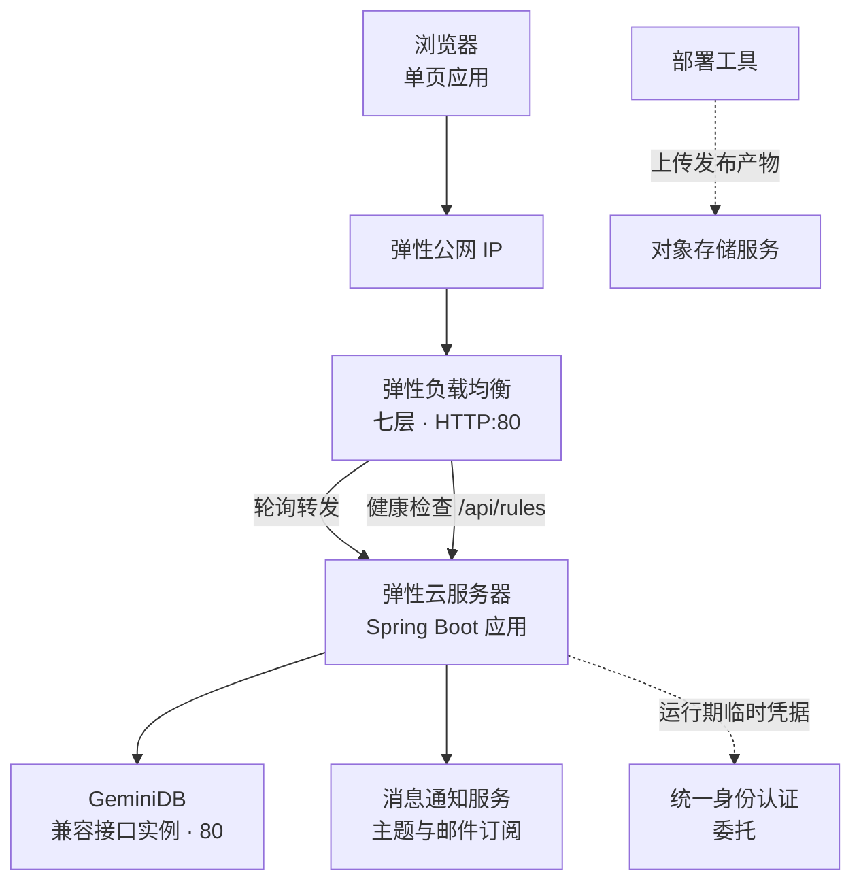

# internet-spring-boot-game-record / 对局记录服务（Java + Spring Boot + GeminiDB + ELB）


## 1. 简介

Scorekeep 是一套可对局的对局记录服务：后端用 Java 与 Spring 提供 HTTP 接口，用于创建与管理场次、参与者、对局与落子记录；前端是一个单页应用，与接口由同一进程提供。服务把一张棋盘的每一次落子完整留痕，并在对局结束时发出一条通知。

本实践在华为云上落地这一服务：计算、接入、宽表存储、对象存储、通知与授权全部使用华为云服务，基础设施以 Terraform 声明。适合希望了解「Java 应用 + 宽表存储 + 七层负载均衡」这一组合如何在华为云组装的读者参考，也可作为 Spring Boot 应用上云的入门样例。

## 2. 目录

- [架构](#架构)
- [方案亮点](#方案亮点)
- [涉及云服务](#涉及云服务)
- [前置条件](#前置条件)
- [快速开始](#快速开始)
- [分步部署](#分步部署)
- [使用方法与验证](#使用方法与验证)
- [清理资源](#清理资源)
- [详细说明](#详细说明)
- [依赖](#依赖)
- [常见问题](#常见问题)
- [贡献指南](#贡献指南)
- [许可证](#许可证)
- [联系方式](#联系方式)

## 3. 架构图



**请求链路**：浏览器经弹性公网 IP 访问七层负载均衡，负载均衡按轮询把请求转发到后端应用实例，并定期探测 `/api/rules` 判断实例是否可用。应用实例同时提供页面与接口，因此页面与接口同域，无需跨域放行。

**数据链路**：应用把参与者、场次、对局、落子、局面五类记录写入 GeminiDB 兼容接口实例。按场次检索对局、按对局检索落子与局面，走实例上的二级索引。

**权限链路**：应用实例绑定统一身份认证委托，运行期从实例元数据获取临时凭据，用于向消息通知服务发布事件；实例上不落任何长期密钥。

**发布链路**：本地构建出可执行包后，由 Terraform 上传到对象存储桶留存，同时经 SSH 下发到应用实例，以系统服务方式常驻运行。

## 4. 方案亮点

- **一套声明式基础设施**：计算、网络、接入、存储、通知、授权共二十余个资源全部由 Terraform 描述，一条命令完成创建，资源依赖关系由编排器推导，无需手工排定顺序。
- **单进程同时提供页面与接口**：前端资源在构建期并入应用包，由同一个 Java 进程提供，页面与接口同域，省去跨域配置与额外的静态托管。
- **数据面凭据不出实例**：应用访问宽表存储使用实例自带的数据库账号，访问通知服务使用委托下发的临时凭据，二者都不需要长期密钥落在实例磁盘上。
- **启动即自建表结构**：应用启动时幂等创建所需表与二级索引，已有表则只补齐缺失索引，首次部署无需手工准备数据面。
- **服务化常驻**：部署过程把应用注册为系统服务并设置自动重启，实例重启后服务自行恢复，无需人工介入。

## 5. 涉及云服务

| 服务 | 本实践中的用途 |
|---|---|
| 弹性云服务器 ECS | 运行 Spring Boot 应用，同时提供页面与接口 |
| 弹性负载均衡 ELB（独享型，七层） | 对外统一入口，按轮询转发请求并做健康检查 |
| 弹性公网 IP EIP | 为负载均衡与运维实例提供公网地址 |
| 虚拟私有云 VPC | 承载子网、安全组与互联网网关，隔离网络边界 |
| 云数据库 GeminiDB（兼容接口） | 存储参与者、场次、对局、落子与局面记录 |
| 对象存储服务 OBS | 存放发布产物 |
| 消息通知服务 SMN | 发布参与者创建与对局结束事件，支持邮件订阅 |
| 统一身份认证 IAM | 以委托形式为实例提供运行期临时凭据 |

> 试用完成后请按「清理资源」一节释放上述资源，避免留下残留。

## 6. 前置条件

**账号与权限**

- 已开通华为云账号，且具备创建 VPC、ECS、ELB、EIP、GeminiDB、OBS、SMN 与 IAM 委托的权限。
- 已在控制台的「我的凭证」页面取得 Access Key 与 Secret Key，并记录账号域名。
- 已开通独享型七层负载均衡。若账号未开通，创建负载均衡时会返回 `ELB.8902`，需先提交工单开通。

**工具版本**

| 工具 | 版本要求 |
|---|---|
| Terraform | 1.5 及以上（本实践在 1.15 上验证） |
| huaweicloud Provider | 1.97 |
| JDK | 17 |
| Gradle | 8.13（仓库内已带包装器，无需单独安装） |
| Bash | Linux / macOS 自带；Windows 建议使用 Git Bash |

**区域与命名约束**

- 本实践默认区域为 `cn-north-4`，可在 `infra/terraform.tfvars` 中修改。
- 对象存储桶名全局唯一，需按实际情况调整，名称须为 3 至 63 位小写字母、数字或连字符。
- 宽表存储的表名长度须为 3 至 48 字符且不含点号，本实践使用 `scorekeep-` 前缀。

**网络**

- 应用实例需要能访问公网以下载运行时依赖与基础软件包，本实践为每台实例绑定一个弹性公网 IP。
- 部署机需要能通过 SSH 访问应用实例，请把 `ssh_source_cidr` 收敛为部署机的出口地址。

## 7. 快速开始

```bash
cd internet-spring-boot-game-record

# 1. 准备配置
cp infra/terraform.tfvars.example infra/terraform.tfvars
# 编辑 infra/terraform.tfvars，至少填写：geminidb_password、ssh_public_key、
# ssh_remote_private_key_path、obs_bucket_name

# 2. 提供访问密钥
export HW_ACCESS_KEY="<your-access-key>"
export HW_SECRET_KEY="<your-secret-key>"

# 3. 构建并部署
bash scripts/1-build.sh
bash scripts/2-deploy.sh

# 4. 查看访问地址
bash scripts/3-open-website.sh
```

## 8. 分步部署

### 第一步：准备配置文件

```bash
cp infra/terraform.tfvars.example infra/terraform.tfvars
```

需要填写的取值：

| 变量 | 说明 |
|---|---|
| `geminidb_password` | 兼容接口实例的管理员密码，8 至 32 位，须同时包含大写字母、小写字母、数字与特殊字符 |
| `delegated_service_name` | 被委托的云服务身份，默认 `op_svc_ecs` |
| `ssh_public_key` | 用于登录应用实例的 SSH 公钥内容 |
| `ssh_remote_private_key_path` | 本地私钥文件路径，供部署期下发应用使用 |
| `obs_bucket_name` | 存放发布产物的桶名，需全局唯一 |
| `notification_email` | 接收通知的邮箱；留空则不创建订阅 |
| `ssh_source_cidr` | 允许 SSH 访问的来源网段，建议收敛为部署机出口地址 |

预期结果：`infra/terraform.tfvars` 存在且各变量已填写。

### 第二步：构建可执行包

```bash
bash scripts/1-build.sh
```

预期输出末尾：

```
构建完成：internet-spring-boot-game-record/src/api/build/libs/scorekeep-api.jar
```

该脚本会依次完成编译、单元测试与打包；测试未通过时构建会中断。

### 第三步：部署基础设施

```bash
export HW_ACCESS_KEY="<your-access-key>"
export HW_SECRET_KEY="<your-secret-key>"
bash scripts/2-deploy.sh
```

脚本依次执行格式检查、配置校验、生成执行计划并应用。预期输出末尾：

```
部署完成。访问地址：
http://<负载均衡公网地址>
```

首次创建 GeminiDB 实例需要较长时间，请耐心等待。

### 第四步：确认实例已就绪

```bash
curl http://<负载均衡公网地址>/api/rules
```

预期返回规则列表：

```
[{"id":"TicTacToe","name":"三子棋","initialState":".........","description":"局面文本为 9 个字符，对应 1-9 号格位；落子文本形如 X5。"}]
```

## 9. 使用方法

### 网页使用

打开 `scripts/3-open-website.sh` 输出的地址，按页面提示完成一次对局：

1. 在首页填写参与者名称与场次名称，点击**创建**，进入场次大厅；不填名称时服务端会随机分配一个。
2. 在大厅中填写对局名称，规则选择**三子棋**，点击**创建**。
3. 点击**开始**进入棋盘，两位参与者轮流点击格位落子。
4. 三子连成一线时页面显示获胜方，同时向订阅邮箱发出一封通知邮件。

### 接口回归验证

```bash
bash scripts/5-test-api.sh http://<负载均衡公网地址>/api
```

该脚本会创建两位参与者与一个场次，开出一局并配置规则，按 `X1 O4 X2 O5 X3` 的顺序落子至终局，校验终局结果与落子记录数，最后清理本次数据。预期输出：

```
结果：通过 9 项，失败 0 项
```

退出码为 0 表示全部检查通过；任一检查失败会打印期望值与实际值。

### 逐项手工核对

| 检查项 | 命令 | 预期 |
|---|---|---|
| 规则列表 | `curl http://<地址>/api/rules` | 返回包含 `TicTacToe` 的数组 |
| 创建参与者 | `curl -X POST http://<地址>/api/user` | 返回 `id` 与随机 `name` |
| 创建场次 | `curl -X POST http://<地址>/api/session` | 返回 `id` |
| 创建对局 | `curl -X POST http://<地址>/api/game/<场次编号>` | 返回含 `session` 字段的对象 |
| 页面可访问 | 浏览器打开站点根路径 | 显示 Scorekeep 首页 |

> 部署完成后，请按本节步骤自行验证，确认业务功能可用，再视为交付完成。

## 10. 清理资源

```bash
bash scripts/6-cleanup.sh
```

该脚本会先列出将销毁的资源并要求输入 `yes` 确认，随后删除本次部署创建的全部资源。注意：对象存储桶会连同其中的发布产物一并删除且不可恢复。

## 11. 详细说明

### 请求与数据模型

服务对外暴露 `user`、`session`、`game`、`move`、`state`、`rules` 六类资源，全部位于 `/api` 路径下。

| 方法与路径 | 说明 |
|---|---|
| `POST /api/user` | 创建参与者；请求体可为空，缺省时随机分配名称 |
| `GET /api/user` | 列出全部参与者 |
| `GET /api/user/{playerId}` | 查询单个参与者 |
| `PUT /api/user/{playerId}` | 覆盖式更新参与者 |
| `DELETE /api/user/{playerId}` | 删除参与者 |
| `POST /api/session` | 创建场次 |
| `GET /api/session` | 列出全部场次 |
| `GET /api/session/{sessionId}` | 查询单个场次 |
| `PUT /api/session/{sessionId}` | 覆盖式更新场次（名称、归属者、参与者） |
| `DELETE /api/session/{sessionId}` | 删除场次 |
| `PUT /api/session/{sessionId}/game/{gameId}` | 把对局登记到该场次下 |
| `POST /api/game/{sessionId}` | 在该场次下创建对局 |
| `GET /api/game/{sessionId}` | 列出该场次下的全部对局 |
| `GET /api/game/{sessionId}/{gameId}` | 查询单个对局 |
| `PUT /api/game/{sessionId}/{gameId}` | 覆盖式更新对局 |
| `DELETE /api/game/{sessionId}/{gameId}` | 删除对局并从场次中移除 |
| `GET /api/game/{sessionId}/{gameId}/name` | 读取对局名称 |
| `PUT /api/game/{sessionId}/{gameId}/name/{name}` | 设置对局名称 |
| `GET /api/game/{sessionId}/{gameId}/rules` | 读取对局所用规则 |
| `PUT /api/game/{sessionId}/{gameId}/rules/{rulesId}` | 设置规则并开出初始局面 |
| `GET /api/game/{sessionId}/{gameId}/user` | 读取对局参与者 |
| `PUT /api/game/{sessionId}/{gameId}/user/{playerId}` | 追加一个参与者 |
| `POST /api/game/{sessionId}/{gameId}/users` | 整组设置参与者，请求体为参与者编号数组 |
| `PUT /api/game/{sessionId}/{gameId}/starttime/{时间戳}` | 设置开始时间 |
| `PUT /api/game/{sessionId}/{gameId}/endtime/{时间戳}` | 设置结束时间 |
| `POST /api/move/{sessionId}/{gameId}/{playerId}` | 落一子，请求体为落子文本，如 `X5` |
| `GET /api/move/{sessionId}/{gameId}` | 列出该对局的全部落子 |
| `GET /api/move/{sessionId}/{gameId}/{moveId}` | 查询单条落子记录 |
| `GET /api/state/{sessionId}/{gameId}` | 列出该对局的全部局面 |
| `GET /api/state/{sessionId}/{gameId}/{stateId}` | 查询单个局面 |
| `GET /api/rules` | 列出可用规则 |
| `GET /api/rules/{rulesId}` | 查询单条规则 |

五类记录分别存放在同名表中，表名前缀由 `TABLE_PREFIX` 决定（缺省 `scorekeep`）。对局表以场次建立二级索引，落子表与局面表以对局建立二级索引。

### 局面编码

局面文本由 9 个字符组成，依次对应棋盘 1 至 9 号格位：`.` 表示空位，`X` 与 `O` 表示已落子。没有胜者时文本长度为 9；出现胜者或和局时，在棋盘前追加一个结果字符，长度为 10：

- `A`：先手方胜
- `B`：后手方胜
- `D`：和局

落子文本由两个字符组成：前一个字符为落子标记，后一个字符为格位号，例如 `X5`。服务端会依次校验标记合法性、格位范围、格位是否已被占用，以及是否轮到该标记落子。落子不合法时接口返回 `400`，请求体为 `{"error":"invalid_request","message":"..."}`。

### 配置项

应用读取以下配置，部署时由 Terraform 写入实例上的配置文件，再由系统服务加载：

| 配置项 | 说明 |
|---|---|
| `GEMINIDB_HOST` | 兼容接口实例的连接地址 |
| `GEMINIDB_PORT` | 数据面端口，由部署形态决定（集群形态 80，单节点形态 8000） |
| `GEMINIDB_USER` | 实例自带的数据库账号，固定为 `rwuser` |
| `GEMINIDB_PASSWORD` | 实例管理员密码 |
| `HW_REGION` | 区域标识，用于请求签名与通知服务接入点拼装 |
| `SMN_TOPIC_URN` | 事件通知主题的 URN；留空则停用通知 |
| `NOTIFICATION_EMAIL` | 通知邮箱；留空则跳过创建邮件订阅 |
| `SERVER_PORT` | 应用监听端口，缺省 8080 |
| `TABLE_PREFIX` | 表名前缀，缺省 `scorekeep` |
| `CORS_ALLOWED_ORIGINS` | 允许跨域的来源，逗号分隔；页面与接口同域时无需设置 |

### 事件通知

服务在两处发布事件：创建参与者并随机分配名称时，以及对局进入终局时。通知主题由 Terraform 创建，邮件订阅需要收件人点击确认链接后才会生效。

## 12. 依赖

| 依赖 | 版本 | 用途 |
|---|---|---|
| Spring Boot | 3.3.13 | Web 应用框架 |
| `software.amazon.awssdk:dynamodb` 与 `software.amazon.awssdk:dynamodb-enhanced` | 2.54.17 | 兼容接口的线协议客户端 |
| `com.huaweicloud.sdk:huaweicloud-sdk-core` | 3.1.216 | 华为云 SDK 公共库 |
| `com.huaweicloud.sdk:huaweicloud-sdk-smn` | 3.1.216 | 消息通知服务客户端 |
| AngularJS | 1.5.8 | 前端框架（已随仓库内置） |
| Bootstrap | 4.0.0-alpha.5 | 前端样式表（已随仓库内置） |
| huaweicloud Provider | 1.97 | Terraform 资源提供方 |

> 前端依赖已内置在 `src/frontend/vendor/`，页面不依赖外部站点，可在无公网出口的浏览器环境中正常加载。

## 13. FAQ

**部署时报 `ELB.8902`**

账号未开通独享型负载均衡。请先提交工单开通，或改用共享型负载均衡并相应调整 `infra/elb.tf`。

**应用启动后接口返回 500**

先查看服务日志：`sudo journalctl -u scorekeep -n 200 --no-pager`。常见原因是宽表存储连接串中的端口与实例部署形态不匹配——集群形态用 80、单节点形态用 8000。先核对端口，再检查安全组是否放通来自应用网段的该端口。

**按场次查询对局返回空列表**

二级索引未创建。应用启动时会自动补齐缺失索引，可重启服务触发：`sudo systemctl restart scorekeep`。

**收不到通知邮件**

邮件订阅需要收件人点击确认链接后生效；同时确认创建参与者时走的是随机分配名称的分支，或对局已进入终局。

**浏览器打开页面为空白**

页面依赖的内置脚本未随包分发。请确认构建时 `src/frontend/` 目录存在，随后重新执行 `scripts/1-build.sh`。

**接口返回 404 且提示资源不存在**

路径中的编号不正确。资源编号区分大小写，请从创建接口的返回体中取用。

## 14. 贡献指南

欢迎提交改进。提交前请确认：

- `bash scripts/1-build.sh` 通过，且测试无失败。
- `cd infra && terraform fmt -check -recursive && terraform validate` 通过。
- 新增规则时，在 `RulesCatalog` 中注册，并补充对应的规则测试。

## 15. 许可证

本实践采用 MIT No Attribution 许可证，详见 [LICENSE](LICENSE)。

## 16. 联系方式

- 维护者：dgc-git
- 问题反馈：请在本仓库提交 Issue
